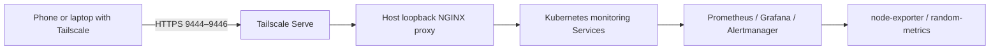

# K3s DevSecOps & Cloud Security Homelab

A single-node Kubernetes lab for practicing Linux, containers, observability,
DevOps, cloud security, and DevSecOps. Last validated: 2026-10-22.

## Current state

- Ubuntu server on repurposed MacBook Air; single-node k3s/containerd.
- Current development devices: Ubuntu laptop, VS Code, and phone.
- Prometheus, Grafana, Alertmanager, node-exporter, and random-metrics deployed.
- random-metrics v0.2.0 has `/metrics`, `/healthz`, probes, resource controls,
  UID/GID 10001, read-only root filesystem, dropped capabilities, restricted
  privilege escalation, RuntimeDefault seccomp, and no service-account token.
- Grafana uses a 1 GiB PVC; credentials and Telegram token are runtime Secrets.
- Monitoring UIs use private Tailscale HTTPS; old HTTP Ingress routes are removed.
- Manifests are manually applied. Helm, CI, GitOps, encrypted secrets,
  policy enforcement, and Terraform remain planned work.

## Private access

Connect your device to the same tailnet and open:

| Application | URL |
|---|---|
| Prometheus | https://ubuntu.tail4beac2.ts.net:9446 |
| Grafana | https://ubuntu.tail4beac2.ts.net:9444 |
| Alertmanager | https://ubuntu.tail4beac2.ts.net:9445 |

Access follows tailnet policy. Grafana additionally requires its existing login.
HTTPS terminates at Tailscale Serve on the host; cluster backend traffic is HTTP.
Do not enable public Funnel for these interfaces.



See the [private access runbook](docs/runbooks/private-monitoring-access.md)
for installation, validation, constraints, and rollback.

## Repository

```text
compose/monitoring/           Historical Compose learning stack; inactive
compose/random-metrics/      Exporter source and Dockerfile
k8s/charts/monitoring/        Plain manifests inside an unfinished Helm skeleton
k8s/private-access/          Loopback proxy manifests
k8s/argocd/                  Planned applications; not ready to enable
k8s/kyverno/                 Policy placeholder
k8s/secrets/                 Encrypted-secret placeholder
k8s/nginx.yml                Separate Kubernetes exercise
docs/                      Roadmap, runbooks, images, and historical notes
```

Empty directories are not tracked by Git. Do not enable Argo CD applications
that reference missing/empty source directories.

## Validate the running lab

```bash
kubectl get nodes
kubectl get deployment,daemonset,pod,svc,pvc -n monitoring
kubectl rollout status deployment/random-metrics -n monitoring --timeout=120s
curl -fsS https://ubuntu.tail4beac2.ts.net:9446/-/ready
curl -fsS https://ubuntu.tail4beac2.ts.net:9444/api/health
curl -fsS https://ubuntu.tail4beac2.ts.net:9445/-/ready
```

In Prometheus, query `up{job="random-metrics"}` (expected 1) and
`my_random_metric` (expected a value between 0 and 100).

## Build and update the exporter

```bash
docker build -t random-metrics:v0.2.0 compose/random-metrics
docker save random-metrics:v0.2.0 -o /tmp/random-metrics-v0.2.0.tar
sudo k3s ctr images import /tmp/random-metrics-v0.2.0.tar
kubectl apply --dry-run=server --validate=strict -f k8s/charts/monitoring/templates/random-metrics-deployment.yml
kubectl apply -f k8s/charts/monitoring/templates/random-metrics-service.yml
kubectl apply -f k8s/charts/monitoring/templates/random-metrics-deployment.yml
```

Use a new tag for future builds and update the Deployment image before applying.
Docker and k3s/containerd use separate image stores.

## Limitations and next work

The cluster is single-node, without HA. Prometheus and Alertmanager have no
persistent data volumes. Several third-party manifests still use `:latest`.
Runtime secrets and manually imported images prevent a fully declarative rebuild.
The chart skeleton includes a reference SealedSecret invalid for this cluster;
do not bulk-apply its templates or activate Argo CD yet.

**Next: finish Helm packaging**, parameterize tested image versions and settings,
escape Prometheus/Alertmanager expressions, and validate rendered resources.
Then add CI/GHCR, recoverable encrypted secrets, GitOps, policy controls,
backup/restore drills, and a scoped Terraform/cloud-security exercise.

- [Roadmap and completion checklist](docs/roadmap.md)
- [Historical architecture and troubleshooting notes](docs/history/pre-private-access.md)

This project was influenced by public examples including
https://github.com/szymonwlach/homelab. Implementations and validation here are
specific to this hardware and cluster.
