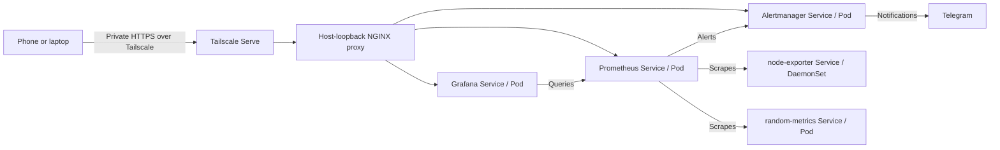

# K3s DevSecOps & Cloud Security Homelab

A hands-on lab for learning DevOps, cloud security, and platform engineering on
repurposed hardware. The project progresses from Linux and containers to
Kubernetes, automated delivery, infrastructure as code, and recovery.

This README is the main project reference and contains the current architecture,
operating instructions, limitations, and roadmap.

## Contents

- [Environment and current state](#environment-and-current-state)
- [Architecture](#architecture)
- [Repository layout](#repository-layout)
- [Access the monitoring stack](#access-the-monitoring-stack)
- [Operate and validate](#operate-and-validate)
- [Build and deploy the exporter](#build-and-deploy-the-exporter)
- [Configure private access](#configure-private-access)
- [Security and limitations](#security-and-limitations)
- [Roadmap](#roadmap)
- [Learning notes](#learning-notes)

## Environment and current state

| Component | Configuration |
|---|---|
| Host | Repurposed MacBook Air running Ubuntu Server |
| Development | Ubuntu laptop, VS Code Remote SSH, and phone |
| Kubernetes | Single-node k3s using containerd; node `ubuntu` |
| Namespace | `monitoring` |
| Observability | Prometheus, Grafana, Alertmanager, node-exporter |
| Application | Python `random-metrics` exporter, image `v0.2.0` |
| Storage | Grafana 1 GiB PVC using local-path storage |
| UI access | Private HTTPS through Tailscale Serve |
| Deployment | Manually applied Kubernetes manifests |

The monitoring stack is deployed. Helm packaging, CI, GitOps, policy enforcement,
encrypted secrets, and Terraform are planned. Files for some of these tools are
scaffolding and do not indicate a working implementation.

## Architecture



Prometheus scrapes itself, node-exporter, and random-metrics at 15-second
intervals. Alert rules cover unavailable targets, low disk space, and low memory.
Grafana queries Prometheus; Alertmanager routes alerts to Telegram.

Traefik and sslip.io Ingress were used during networking exercises. Monitoring
UI Ingress routes have been retired in favor of private HTTPS access. Traefik
remains installed as part of the cluster.

## Repository layout

```text
compose/
  monitoring/                 Inactive Compose stack retained for learning
  random-metrics/             Python exporter and Dockerfile
k8s/
  charts/monitoring/           Plain manifests in an unfinished Helm skeleton
  private-access/proxy.yml    Loopback-only monitoring proxy
  argocd/                     Application scaffolding; not active
  nginx.yml                   Separate Kubernetes exercise
docs/
  troubleshooting.md          Troubleshooting lessons
  images/                     Architecture artwork
```

Argo CD scaffolding also references `k8s/kyverno` and `k8s/secrets`. These paths
have no tracked resources yet. Do not activate the applications until their
sources and prerequisites are ready.

## Access the monitoring stack

Connect the device to the same Tailscale network, then open:

| Application | Address |
|---|---|
| Prometheus | https://ubuntu.tail4beac2.ts.net:9446 |
| Grafana | https://ubuntu.tail4beac2.ts.net:9444 |
| Alertmanager | https://ubuntu.tail4beac2.ts.net:9445 |

Grafana requires its existing admin credentials. They are held in the
`grafana-secret` Kubernetes Secret; do not copy credentials into Git or logs.

For temporary troubleshooting, forward the Prometheus Service:

```bash
kubectl port-forward -n monitoring service/prometheus 9090:9090
```

Open `http://localhost:9090` on the machine running that command. For a remote
VS Code session, forward port 9090 through the Ports panel to reach it from the
local browser.

## Operate and validate

Inspect workloads and routing:

```bash
kubectl get nodes
kubectl get deployment,daemonset,pod,svc,pvc -n monitoring
kubectl get endpointslices -n monitoring
kubectl logs -n monitoring deployment/random-metrics --tail=30
kubectl describe pods -n monitoring -l app=random-metrics
```

Check the private HTTPS backends:

```bash
curl -fsS https://ubuntu.tail4beac2.ts.net:9446/-/ready
curl -fsS https://ubuntu.tail4beac2.ts.net:9444/api/health
curl -fsS https://ubuntu.tail4beac2.ts.net:9445/-/ready
```

In Prometheus, query `up{job="random-metrics"}` and expect `1`. Query
`my_random_metric` for a value between 0 and 100. The exporter exposes
`/metrics` and `/healthz`; unknown paths return 404.

Server-side dry runs validate resources without deploying them:

```bash
kubectl apply --dry-run=server --validate=strict \
  -f k8s/charts/monitoring/templates/random-metrics-deployment.yml
```

A ready Pod alone does not prove that scraping or alert delivery works. Validate
those paths separately. The Telegram alerting chain was exercised through an
intentional exporter outage and subsequent recovery.

## Build and deploy the exporter

Run from the repository root on the k3s host. This example uses the current image
tag; choose a new tag for a changed build and update the Deployment to match.

```bash
docker build -t random-metrics:v0.2.0 compose/random-metrics
docker save random-metrics:v0.2.0 -o /tmp/random-metrics-v0.2.0.tar
sudo k3s ctr images import /tmp/random-metrics-v0.2.0.tar
kubectl apply --dry-run=server --validate=strict -f k8s/charts/monitoring/templates/random-metrics-deployment.yml
kubectl apply -f k8s/charts/monitoring/templates/random-metrics-service.yml
kubectl apply -f k8s/charts/monitoring/templates/random-metrics-deployment.yml
kubectl rollout status deployment/random-metrics -n monitoring --timeout=120s
```

Docker and k3s/containerd have separate image stores. The import is necessary
until registry-based delivery is implemented.

For a failed rollout, inspect Pod events and logs before changing configuration.
To restore the previous rollout temporarily:

```bash
kubectl rollout undo deployment/random-metrics -n monitoring
kubectl rollout status deployment/random-metrics -n monitoring --timeout=120s
```

Also restore the intended configuration in Git so the next apply does not
reintroduce the failure.

## Configure private access

This procedure assumes a working monitoring namespace and a Tailscale-connected
host. The proxy targets node `ubuntu` and cluster DNS `10.43.0.10`; adjust those
settings for another installation.

```bash
kubectl apply --dry-run=server --validate=strict -f k8s/private-access/proxy.yml
kubectl apply -f k8s/private-access/proxy.yml
kubectl rollout status deployment/monitoring-private-proxy -n monitoring --timeout=120s
sudo tailscale serve --bg --https=9446 http://127.0.0.1:19090
sudo tailscale serve --bg --https=9444 http://127.0.0.1:13000
sudo tailscale serve --bg --https=9445 http://127.0.0.1:19093
tailscale serve status
```

The proxy listens only on host loopback. Tailscale terminates HTTPS and forwards
to it; backend traffic within the cluster uses HTTP. Dedicated ports avoid the
Traefik conflict encountered on port 443. Access follows tailnet permissions;
Tailscale Serve does not add Grafana-style application login to the other UIs.

Validate access from a connected device, including over mobile data. Disconnect
Tailscale and confirm the private URLs stop working. Review tailnet access rules
for the intended users and devices. Public Funnel is not used.

After changing the proxy ConfigMap, restart its Deployment to load the change:

```bash
kubectl rollout restart deployment/monitoring-private-proxy -n monitoring
kubectl rollout status deployment/monitoring-private-proxy -n monitoring --timeout=120s
```

To remove private UI access:

```bash
sudo tailscale serve --https=9446 off
sudo tailscale serve --https=9444 off
sudo tailscale serve --https=9445 off
kubectl delete -f k8s/private-access/proxy.yml
```

This leaves the monitoring stack and its storage intact. Use port-forwarding
for temporary access afterward.

## Security and limitations

- The exporter runs as UID/GID 10001 with a read-only root filesystem, dropped
  capabilities, blocked privilege escalation, and RuntimeDefault seccomp.
- Readiness and liveness probes use `/healthz`. CPU/memory requests and limits
  are configured, and service-account token mounting is disabled.
- Grafana credentials and the Telegram token are runtime Kubernetes Secrets.
  Secret resources require access control; their values are not committed.
- The single-node cluster and local storage provide no high availability.
  Prometheus and Alertmanager do not currently have persistent data volumes.
- Several third-party workloads use `:latest`. Registry delivery, backup/restore,
  and automated validation are not complete.
- `Chart.yml` and `values.yml` are unfinished Helm scaffolding. Embedded
  Prometheus and Alertmanager expressions need escaping before Helm rendering.
- The chart contains a reference SealedSecret invalid for this cluster. Do not
  bulk-apply its templates or enable Argo CD against the chart yet.

## Roadmap

This is the project's only progress checklist. Checked items are implemented
learning milestones; unchecked items remain planned. Earlier Ingress work is
retained as a completed exercise, while private HTTPS is the current access path.

### Phase 1 — Host and remote administration

- [x] Repurpose hardware and install Ubuntu Server.
- [x] Configure SSH and VS Code Remote SSH.
- [x] Practice Linux permissions, processes, and network troubleshooting.

### Phase 2 — Docker and initial monitoring

- [x] Build the Compose stack with Prometheus, Grafana, and node-exporter.
- [x] Build the Python exporter image.
- [x] Use volumes, service networking, and environment-based configuration.
- [x] Stop the old Compose stack after migrating monitoring to Kubernetes.

### Phase 3 — Kubernetes fundamentals

- [x] Install k3s and configure kubectl.
- [x] Deploy monitoring workloads in the monitoring namespace.
- [x] Use Deployments, a DaemonSet, ConfigMaps, Secrets, and Services.
- [x] Add Grafana persistent storage.
- [x] Configure alert rules and Telegram notifications.
- [x] Exercise an outage and confirm alert delivery and recovery.

### Phase 4 — Networking and private access

- [x] Practice Traefik Ingress and sslip.io hostname routing.
- [x] Verify Service DNS, selectors, and EndpointSlices.
- [x] Replace the unnecessary Grafana NodePort with ClusterIP.
- [x] Configure loopback proxy and private Tailscale HTTPS access.
- [x] Verify phone access over mobile data and Grafana login.
- [x] Retire old monitoring HTTP Ingress routes and conflicting Serve listener.
- [ ] Verify private URLs fail with Tailscale disconnected on the client.
- [ ] Review tailnet permissions for intended users and devices.

### Phase 5 — Custom workload and hardening

- [x] Build and import random-metrics v0.2.0 into k3s/containerd.
- [x] Deploy a single authoritative Deployment and ClusterIP Service.
- [x] Expose /metrics and /healthz; return 404 for unknown paths.
- [x] Verify exporter scraping and the custom metric in Prometheus.
- [x] Set scrape and evaluation intervals to 15 seconds.
- [x] Add readiness and liveness probes.
- [x] Configure CPU and memory requests and limits.
- [x] Run as non-root UID/GID 10001 with RuntimeDefault seccomp.
- [x] Use a read-only root filesystem, drop capabilities, and block privilege escalation.
- [x] Disable automatic service-account token mounting.

### Phase 6 — Helm packaging — next milestone

- [ ] Complete Chart.yaml and values.yaml using the required filenames.
- [ ] Template images/tags, replicas, storage, resources, and Secret references.
- [ ] Use release namespace and consistent labels in templates.
- [ ] Escape Prometheus alert expressions and Alertmanager message templates.
- [ ] Remove the invalid reference SealedSecret and empty placeholders.
- [ ] Pass helm lint and inspect helm template output.
- [ ] Validate rendered Kubernetes resources against API schemas.
- [ ] Plan and test Helm ownership migration while preserving Grafana data.

### Phase 7 — CI and image delivery

- [ ] Add GitHub Actions checks for application behavior and syntax.
- [ ] Lint/render Helm and validate rendered manifests in CI.
- [ ] Add secret scanning and Trivy repository/image scans.
- [ ] Build the exporter and publish identifiable images to GHCR.
- [ ] Use minimum workflow permissions and reviewed action revisions.
- [ ] Replace manual containerd imports with registry-based delivery.
- [ ] Pin tested third-party image versions and trace deployments to source commits.

### Phase 8 — Secrets management

- [ ] Install the Sealed Secrets controller.
- [ ] Seal Grafana and Telegram credentials for this cluster.
- [ ] Commit encrypted resources without exposing plaintext values.
- [ ] Back up controller keys outside Git.
- [ ] Test Secret restoration and document credential rotation.

### Phase 9 — GitOps

- [ ] Install Argo CD and connect the repository.
- [ ] Configure a scoped project and explicit resource ownership.
- [ ] Reconcile secrets before workloads that depend on them.
- [ ] Review the first monitoring sync and resolve existing ownership.
- [ ] Test drift detection and self-healing.
- [ ] Review pruning and rollback behavior before enabling automation.
- [ ] Use Git as the normal source of desired deployment state.

### Phase 10 — Policy as code

- [ ] Install Kyverno and introduce policies in audit mode.
- [ ] Check image references, standard labels, and resource settings.
- [ ] Require appropriate non-root and privilege restrictions.
- [ ] Document narrow exceptions for node-exporter host access.
- [ ] Test accepted and denied manifests before enforcing policies.

### Phase 11 — Persistence and recovery

- [ ] Define Prometheus retention and monitoring persistence requirements.
- [ ] Back up Grafana data, required cluster state, and sealing keys.
- [ ] Perform a restore drill and record recovery time and data loss.
- [ ] Document bootstrap, application rollback, and complete rebuild steps.
- [ ] Verify access controls and required network flows during recovery.

### Phase 12 — Terraform and cloud security

- [ ] Define a small Terraform-managed cloud exercise and state strategy.
- [ ] Practice least-privilege IAM, private networking, and encryption.
- [ ] Enable audit logging and CI federation without long-lived credentials.
- [ ] Configure budget controls and document intentionally manual steps.
- [ ] Test repeatable provisioning and complete teardown.

The portfolio target is a reproducible deployment with automated validation,
traceable images, recoverable secrets and data, and documented operating steps.

## Learning notes

[The troubleshooting notes](docs/troubleshooting.md) preserve lessons from the
lab without duplicating current setup instructions or the roadmap.

The [architecture artwork](docs/images/Homelab-DevSecOps-Monitoring-Architecture.png)
illustrates a target design; the architecture above describes the implemented
system. Public examples, including
[szymonwlach/homelab](https://github.com/szymonwlach/homelab), informed the learning
path. This implementation is adapted to its own hardware and constraints.
