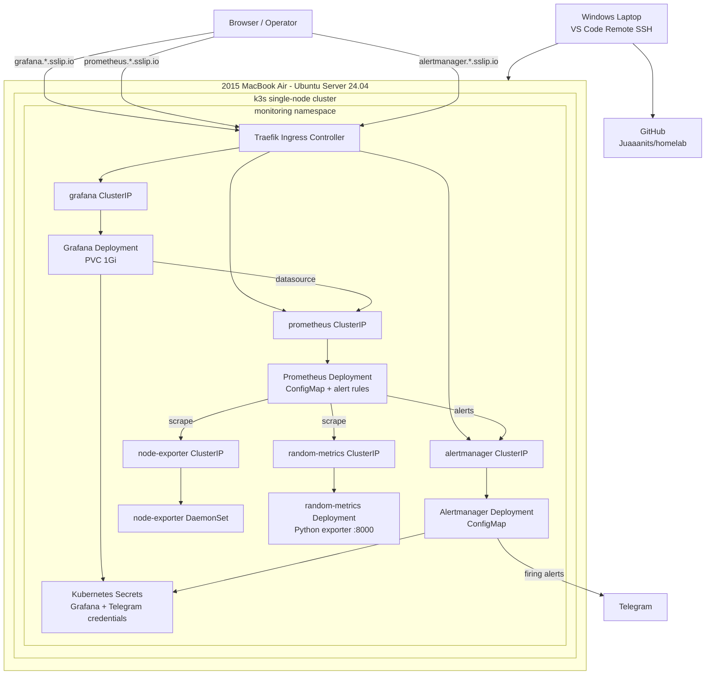
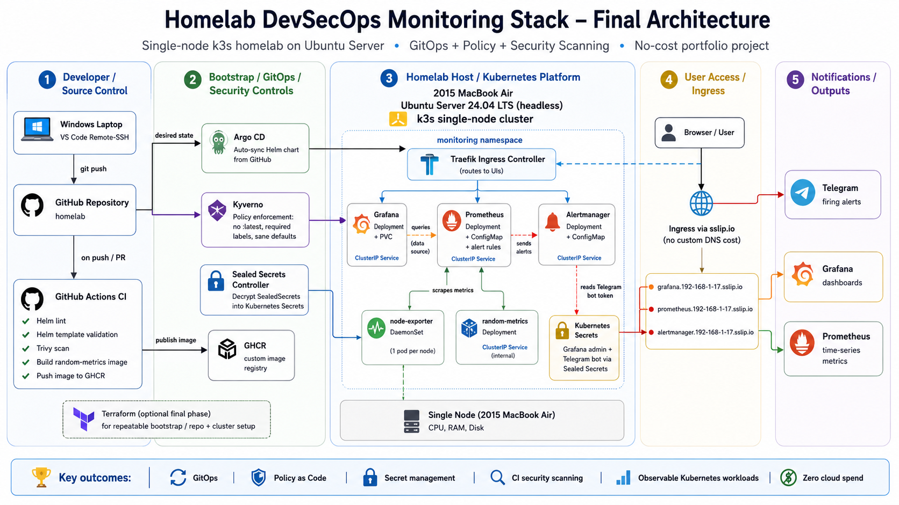
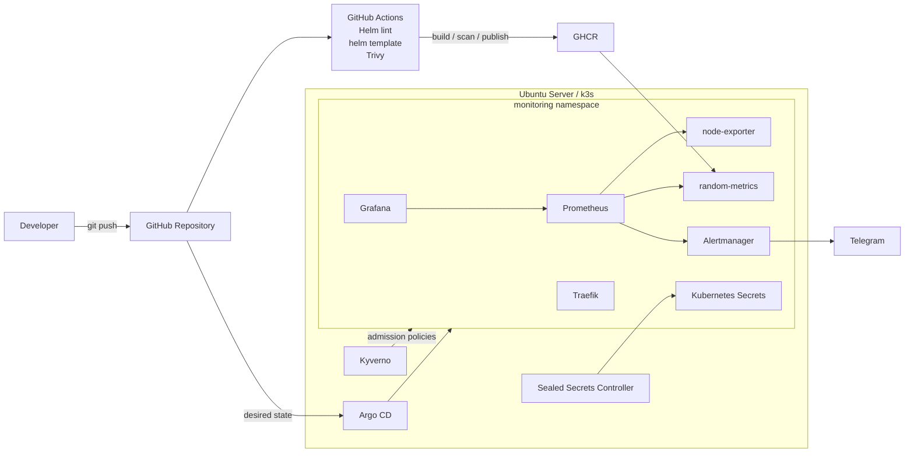

# K3s DevSecOps & Platform Engineering Homelab

> **Access update (2026-10-22):** Monitoring UIs now use private Tailscale HTTPS:
> [Prometheus](https://ubuntu.tail4beac2.ts.net:9446),
> [Grafana](https://ubuntu.tail4beac2.ts.net:9444), and
> [Alertmanager](https://ubuntu.tail4beac2.ts.net:9445).
> The three monitoring HTTP Ingress routes have been retired.
> See [private access setup, validation, and rollback](docs/runbooks/private-monitoring-access.md).
> Earlier Ingress examples below describe the historical learning phase.

A hands-on Kubernetes monitoring and DevSecOps homelab built on repurposed hardware to practice production-oriented platform engineering without paid cloud infrastructure.

> **Current status:** Prometheus, Grafana, Alertmanager, node-exporter, Traefik Ingress, and a custom Python metrics exporter are operational on a single-node k3s cluster. Helm, CI security scanning, Argo CD, Kyverno, Sealed Secrets, and Terraform are the next phases.

---

## Project Goal

I built this project to learn DevOps and platform engineering by designing, deploying, breaking, troubleshooting, and improving the stack myself rather than copying a finished tutorial.

The project intentionally progresses through:

1. Linux and SSH administration
2. Docker / Docker Compose monitoring
3. k3s and Kubernetes fundamentals
4. Prometheus, Grafana, Alertmanager, and node-exporter
5. Kubernetes Services, DNS, EndpointSlices, and Ingress
6. A custom application migrated into Kubernetes
7. Workload hardening
8. Helm
9. GitHub Actions and Trivy
10. GHCR
11. Argo CD GitOps
12. Kyverno policy-as-code
13. Sealed Secrets
14. Terraform

The objective is not to pretend a single-node homelab is a production HA cluster. The objective is to demonstrate that I understand the components, failure modes, tradeoffs, and operational workflow behind a production Kubernetes platform.

---

## Environment

| Component | Details |
|---|---|
| Host | 2015 MacBook Air |
| CPU | Intel Core i5 |
| Memory | 8 GB RAM |
| OS | Ubuntu Server 24.04 LTS |
| Access | Headless via SSH |
| Development workstation | Windows laptop |
| Editor workflow | VS Code Remote SSH |
| Kubernetes | k3s |
| Cluster topology | Single node |
| Node | `ubuntu` |
| k3s runtime | containerd |
| Namespace | `monitoring` |
| Ingress controller | Traefik |
| DNS pattern | `sslip.io` |
| Repository | `github.com/Juaaanits/homelab` |

This project is designed to remain at or near zero recurring infrastructure cost.

---

# Architecture

## Current Architecture



## Target DevSecOps Architecture

> The diagram below represents the planned final state of the homelab.
> Components such as Argo CD, Kyverno, Sealed Secrets, GitHub Actions,
> GHCR automation, and Terraform are being implemented progressively
> and should not be interpreted as already completed.





---

# Repository Layout

```text
homelab/
├── compose/
│   ├── monitoring/                  # old Compose monitoring stack; no longer running
│   └── random-metrics/
│       ├── Dockerfile
│       └── app.py
│
└── k8s/
    ├── charts/
    │   └── monitoring/
    │       └── templates/
    │           ├── alertmanager-configmap.yml
    │           ├── alertmanager-deployment.yml
    │           ├── alertmanager-ingress.yml
    │           ├── grafana-deployment.yml
    │           ├── grafana-ingress.yml
    │           ├── grafana-pvc.yml
    │           ├── node-exporter-daemonset.yml
    │           ├── prometheus-configmap.yml
    │           ├── prometheus-deployment.yml
    │           ├── prometheus-ingress.yml
    │           ├── prometheus-rules-configmap.yml
    │           ├── random-metrics-deployment.yml
    │           ├── random-metrics-service.yml
    │           └── services.yml
    ├── argocd/
    ├── kyverno/
    └── secrets/
```

The monitoring files are still plain Kubernetes manifests. The existing chart skeleton is not yet the authoritative deployment mechanism.

---

# Implemented Stack

## Prometheus

Prometheus runs as a Kubernetes Deployment.

Current static targets:

```text
localhost:9090
node-exporter:9100
random-metrics:8000
```

Current global settings:

```yaml
global:
  scrape_interval: 15s
  evaluation_interval: 15s
```

Alert rules include:

- `TargetDown`
- `DiskUsageCritical`
- `RAMUsageCritical`

The alerts have been tested through real failure scenarios rather than only syntax validation.

## Grafana

Grafana runs as a Deployment with a `1Gi` `ReadWriteOnce` PVC.

Admin credentials are stored in a Kubernetes Secret and are not committed in plaintext.

Grafana was originally exposed through a NodePort. After Traefik Ingress became the standard access path, the Service was changed to `ClusterIP`.

## Alertmanager

Alertmanager receives Prometheus alerts and routes notifications to Telegram.

The Telegram bot token is stored in a Kubernetes Secret, mounted as a file, and consumed through `bot_token_file`. Credentials are not embedded in the Alertmanager ConfigMap.

## node-exporter

node-exporter runs as a DaemonSet because its purpose is tied to node-level metrics.

```text
1 Kubernetes node
=
1 node-exporter Pod
```

A ClusterIP Service provides the stable Prometheus scrape target `node-exporter:9100`.

## random-metrics

`random-metrics` is a small custom Python exporter used to learn the full application-to-observability path.

It exposes:

```text
my_random_metric <random number from 0 to 100>
```

Current image:

```text
random-metrics:v0.1.0
```

Current path:

```text
Python source
  ↓
Docker image
  ↓
k3s containerd
  ↓
Deployment
  ↓
ReplicaSet
  ↓
Pod :8000
  ↓
ClusterIP Service
  ↓
random-metrics:8000
  ↓
Prometheus
```

The first migration used a manual image import into k3s/containerd. GHCR publishing through CI is planned to make a clean-cluster deployment reproducible.

---

# Networking

## Ingress

Traefik is the cluster's default IngressClass, and the manifests explicitly declare:

```yaml
ingressClassName: traefik
```

Current UI hostnames:

```text
grafana.192-168-1-17.sslip.io
prometheus.192-168-1-17.sslip.io
alertmanager.192-168-1-17.sslip.io
```

`sslip.io` allows hostname-based routing without buying a domain or managing a local DNS server.

## Kubernetes Routing Model

The project reinforced that an Ingress routes to a Service, not directly to Pods:

```text
Client
  ↓
Traefik
  ↓
Ingress
  ↓
Service
  ↓
EndpointSlice
  ↓
Pod
```

Prometheus uses the same stable-abstraction principle:

```text
Prometheus
  ↓
Kubernetes DNS
  ↓
Service
  ↓
EndpointSlice
  ↓
Exporter Pod
```

Pod IPs are treated as disposable.

---

# End-to-End Alert Test

The monitoring pipeline was tested by intentionally forcing a real outage.

```text
working node-exporter
    ↓
intentionally break image tag
    ↓
node-exporter unavailable
    ↓
Prometheus target fails
    ↓
TargetDown Pending
    ↓
TargetDown Firing
    ↓
Prometheus → Alertmanager
    ↓
Alertmanager → Telegram
    ↓
valid image restored
    ↓
target recovers
    ↓
alert clears
```

This validated the alerting chain end to end.

---

# Troubleshooting Journal

The troubleshooting history is intentionally documented because diagnosing the system was one of the primary learning goals.

## 1. `TargetDown` Fired Even Though node-exporter Existed

**Symptom:** Prometheus reported `node-exporter` as unavailable.

**Investigation:** The DaemonSet Pod was running, but Prometheus scraped `node-exporter:9100` and no Service named `node-exporter` existed.

**Root cause:** A Pod existed without the stable Service/DNS abstraction expected by Prometheus.

**Fix:** Added a ClusterIP Service on port `9100` with a selector matching the node-exporter Pod.

**Lesson:**

```text
Pod != Service
```

A running Pod does not automatically create a stable DNS target.

---

## 2. DaemonSet and `kubectl cordon` Behavior Was Misunderstood

**Symptom:** Cordoning the node did not make the DaemonSet behave like a normal Deployment being prevented from scheduling.

**Root cause:** DaemonSets use special scheduling behavior because their purpose is to maintain a Pod on eligible nodes.

**Lesson:** A DaemonSet represents node coverage, not a normal fixed-replica workload.

---

## 3. `kubectl port-forward` Died on Pod Restarts

**Symptom:** UI access disappeared every time the target Pod restarted.

**Root cause:** Port-forward is a temporary debugging connection, not durable application exposure.

**Fix:** Moved Grafana, Prometheus, and Alertmanager to Traefik Ingress.

**Lesson:** Port-forward is excellent for debugging but should not be treated as stable service exposure.

---

## 4. Prometheus Ingress Returned 404

**Symptom:** The Prometheus hostname reached Traefik but returned a 404.

**Investigation:** The Ingress backend referenced:

```text
prometheus-server
```

while the real Service was:

```text
prometheus
```

**Root cause:** Kubernetes resource names must match exactly.

**Fix:** Changed the Ingress backend to `prometheus:9090` and verified it against `kubectl get svc -n monitoring`.

**Lesson:** Cross-check live resource names instead of trusting memory or copied manifests.

---

## 5. Ingress Worked Through a Default Class, but the Dependency Was Implicit

**Observation:** k3s reported:

```text
traefik (default)
```

so an Ingress could work without clearly communicating the controller dependency in the source file.

**Improvement:** Added:

```yaml
ingressClassName: traefik
```

**Lesson:** Explicit manifests are easier to understand and more portable than configuration that only works because of cluster defaults.

---

## 6. `curl -I` Returned HTTP 405

**Symptom:** Prometheus and Alertmanager returned `405 Method Not Allowed`.

**Root cause:** `curl -I` sends a `HEAD` request. The tested endpoints accepted GET but not HEAD.

**Validation:** Normal GET requests worked. Prometheus redirected `/` to `/query` and then returned HTTP 200.

**Lesson:** A 405 can actually prove that routing succeeded and the request reached the backend application.

---

## 7. Grafana Still Had a NodePort After Ingress Worked

**Observation:** Grafana was reachable both through Traefik and directly through node port `30455`.

**Risk:** The NodePort created an unnecessary second external access path.

**Fix:** Changed the Grafana Service from `NodePort` to `ClusterIP`.

**Validation:**

```text
Ingress path       → works
192.168.1.17:30455 → no longer reachable
```

**Lesson:** Once a standard ingress path exists, remove unnecessary exposure to reduce attack surface.

---

## 8. Plaintext Secret Near-Miss

**Situation:** A plaintext Kubernetes Secret manifest was created during an early stage.

**Result:** The problem was caught before the secret entered Git history.

**Fix:** Runtime secrets were created directly in Kubernetes and the plaintext file was not committed.

**Lesson:** Secret hygiene must be part of the normal Git workflow. `.gitignore` is useful but is not a complete secrets-management strategy.

---

## 9. A SealedSecret From a Reference Repository Was Invalid Here

**Situation:** A `grafana-sealed-secret.yml` file existed from the public reference project.

**Root cause:** Sealed Secrets ciphertext is tied to the key pair of the controller that sealed it.

**Decision:** The file is treated as dead/invalid and is not applied.

**Lesson:** Encrypted configuration is not automatically portable between clusters.

---

## 10. `kubeseal` CLI Existed but the Controller Did Not

**Symptom:** An earlier Sealed Secrets attempt could not form a working flow.

**Root cause:** The local `kubeseal` binary existed, but the cluster-side controller was not installed.

**Lesson:**

```text
kubeseal CLI
+
Sealed Secrets Controller
=
working SealedSecret flow
```

Client and controller solve different parts of the problem.

---

## 11. ConfigMap Changes Did Not Mean the Application Had Reloaded Them

**Observation:** Applying a ConfigMap does not guarantee a long-running process automatically consumes the new content.

**Fix:** After Prometheus ConfigMap changes:

```bash
kubectl apply -f ...
kubectl rollout restart deployment/prometheus -n monitoring
kubectl rollout status deployment/prometheus -n monitoring
```

**Lesson:**

```text
local YAML
  ↓
Kubernetes ConfigMap
  ↓
mounted configuration
  ↓
application runtime state
```

Each layer should be verified.

---

## 12. Docker Had the random-metrics Image but k3s Did Not

**Symptom:**

```bash
docker images
```

showed the custom image, but:

```bash
sudo k3s ctr images list
```

did not.

**Root cause:**

```text
Docker image store != k3s/containerd image store
```

Even on the same physical machine, the runtimes do not automatically share local images.

**Fix:** Rebuilt the image as `random-metrics:v0.1.0`, exported it, and imported it into k3s/containerd.

**Validation:** Kubernetes reported the image was already present on the machine and the Pod started successfully.

**Lesson:** The image must be available to the runtime Kubernetes actually uses or be pullable from a registry.

---

## 13. The First random-metrics Files Were YAML but Not Kubernetes Resources

**Symptom:**

```text
apiVersion not set
kind not set
```

**Root cause:** The first draft described properties such as name, replicas, and port without the Kubernetes API resource structure.

**Fix:** Rebuilt the files as proper:

```text
apps/v1 Deployment
v1 Service
```

using:

```yaml
apiVersion:
kind:
metadata:
spec:
```

**Lesson:** YAML is only a serialization format. Valid YAML is not automatically a valid Kubernetes manifest.

---

## 14. Image Tag YAML Was Initially Structured Incorrectly

**Incorrect:**

```yaml
image:
  random-metrics: v0.1.0
```

**Correct:**

```yaml
image: random-metrics:v0.1.0
```

**Lesson:** Small YAML formatting changes can alter the data structure sent to Kubernetes.

---

## 15. Deployment Was Missing From a Label-Filtered Query

**Symptom:**

```bash
kubectl get deployment,replicaset,pod -l app=random-metrics
```

returned the ReplicaSet and Pod but initially not the Deployment.

**Investigation:** The Deployment itself had no `metadata.labels`, even though its Pod template used `app: random-metrics`.

**Lesson:** These are different:

```text
metadata.labels
→ labels the Deployment object

spec.selector.matchLabels
→ selects Pods controlled by the Deployment

template.metadata.labels
→ labels Pods created from the template
```

A `kubectl -l` query filters the metadata labels of each queried object.

---

## 16. Kubernetes DNS Was Tested From Inside the Cluster

A temporary BusyBox Pod requested:

```text
http://random-metrics:8000/metrics
```

and received:

```text
my_random_metric <value>
```

This proved:

```text
temporary Pod
   ↓
CoreDNS
   ↓
random-metrics Service
   ↓
EndpointSlice
   ↓
random-metrics Pod
   ↓
Python HTTP server
```

**Lesson:** `kubectl get svc` alone does not prove the full data path works.

---

## 17. Temporary Test Pod Exited Before `kubectl` Finished Attaching

**Symptom:** The metric was returned successfully, followed by an attach warning stating that no running task was found.

**Root cause:** `wget` completed so quickly that the temporary Pod exited before the interactive attach completed. `kubectl` then fell back to streaming logs.

**Lesson:** Interpret warnings in the context of workload lifecycle and actual test output.

---

## 18. Prometheus Used a 1-Minute Scrape Interval Instead of the Intended 15 Seconds

**Symptom:** Prometheus target API reported:

```text
scrapeInterval: 1m
```

**Investigation:**

Local file:

```yaml
scrape_interval:
```

Live ConfigMap:

```yaml
scrape_interval:
```

Prometheus runtime API:

```yaml
scrape_interval: 1m
```

**Root cause:** The intended value had accidentally been left empty, so Prometheus used its effective default.

**Fix:**

```yaml
global:
  scrape_interval: 15s
  evaluation_interval: 15s
```

Then Prometheus was restarted.

**Validation:** All current targets reported `health: up` and `scrapeInterval: 15s`.

**Lesson:** Debug configuration through every layer:

```text
intent
  ↓
local file
  ↓
Kubernetes object
  ↓
application-loaded config
  ↓
runtime behavior
```

---

# Current Validation State

Expected Prometheus targets:

```text
node             UP   15s
prometheus       UP   15s
random-metrics   UP   15s
```

Custom metric:

```promql
my_random_metric
```

Expected labels:

```text
instance="random-metrics:8000"
job="random-metrics"
```

Ingress validation:

```text
Grafana      → redirect to login → HTTP 200
Prometheus   → redirect to /query → HTTP 200
Alertmanager → HTTP 200
```

---

# Useful Operational Commands

## Workloads

```bash
kubectl get pods -n monitoring
kubectl get deployments -n monitoring
kubectl get daemonsets -n monitoring
```

## Services and routing

```bash
kubectl get svc -n monitoring
kubectl get ingress -n monitoring
kubectl get ingressclass
kubectl get endpointslices -n monitoring
```

## Troubleshooting

```bash
kubectl describe pod -n monitoring <pod>
kubectl logs -n monitoring <pod>
```

## Validate before applying

```bash
kubectl apply --dry-run=client -f <manifest>
```

## Prometheus rollout

```bash
kubectl rollout restart deployment/prometheus -n monitoring
kubectl rollout status deployment/prometheus -n monitoring
```

## Prometheus runtime configuration

```bash
curl -s   http://prometheus.192-168-1-17.sslip.io/api/v1/status/config   | jq -r '.data.yaml'
```

## Prometheus target health

```bash
curl -s   http://prometheus.192-168-1-17.sslip.io/api/v1/targets   | jq '.data.activeTargets[] | {
      job: .labels.job,
      health: .health,
      scrapeInterval: .scrapeInterval,
      lastError: .lastError
    }'
```

## Query custom metric

```bash
curl -sG   http://prometheus.192-168-1-17.sslip.io/api/v1/query   --data-urlencode 'query=my_random_metric'   | jq '.data.result'
```

---

# Security Decisions

- No Grafana passwords or Telegram bot tokens are intentionally committed to Git.
- The Telegram token is mounted into Alertmanager as a Secret-backed file.
- Grafana's obsolete NodePort exposure was removed after Ingress was established.
- The custom image uses a versioned tag (`v0.1.0`) rather than `:latest`.
- Third-party images still using `:latest` will be pinned before Kyverno enforcement.
- The invalid SealedSecret copied from a reference cluster is not used.

---

# Known Limitations

## Single node

This is not a highly available cluster. Hardware or OS failure takes down the environment.

## No TLS yet

The current `sslip.io` Ingress routes use HTTP.

## Static Prometheus targets

Prometheus intentionally uses `static_configs` before introducing `kubernetes_sd_configs`. This keeps the current learning phase focused on Service DNS and Kubernetes networking.

## Custom image is manually imported

`random-metrics:v0.1.0` currently exists in k3s/containerd through manual import. GHCR will make image delivery reproducible.

## Secrets are not GitOps-compatible yet

Secrets are kept out of Git but cannot yet be recreated declaratively from repository state. Sealed Secrets is planned.

## Helm is not active yet

The current YAML files are still manually applied. Helm chart conversion is planned.

A known future Helm issue is that Prometheus alert annotations use Prometheus templates such as:

```text
{{ $labels.instance }}
```

which collide with Helm's `{{ }}` syntax and will need proper escaping.

---

# DevSecOps Roadmap

## Phase 1 - Host and remote administration

- [x] Repurpose MacBook Air
- [x] Install Ubuntu Server 24.04
- [x] Configure SSH
- [x] Develop through VS Code Remote SSH

## Phase 2 - Initial monitoring stack

- [x] Docker / Docker Compose monitoring
- [x] Prometheus
- [x] Grafana
- [x] Alertmanager
- [x] node-exporter
- [x] custom Python exporter
- [x] Tear down old Compose stack after Kubernetes migration

## Phase 3 - Kubernetes fundamentals

- [x] Install k3s
- [x] Configure `kubectl`
- [x] Create `monitoring` namespace
- [x] Deploy Prometheus
- [x] Deploy Grafana
- [x] Add Grafana persistent storage
- [x] Deploy node-exporter as DaemonSet
- [x] Deploy Alertmanager
- [x] Configure Services
- [x] Configure alerts
- [x] Validate Telegram alerting with a real forced outage

## Phase 4 - Networking

- [x] Traefik Ingress
- [x] `sslip.io`
- [x] Grafana Ingress
- [x] Prometheus Ingress
- [x] Alertmanager Ingress
- [x] Remove unnecessary Grafana NodePort
- [x] Verify Ingress → Service → EndpointSlice → Pod

## Phase 5 - Custom Kubernetes workload

- [x] Build `random-metrics:v0.1.0`
- [x] Import image into k3s/containerd
- [x] Deploy with Deployment
- [x] Add ClusterIP Service
- [x] Verify in-cluster DNS
- [x] Add Prometheus scrape target
- [x] Query `my_random_metric`
- [x] Configure explicit 15-second scrape/evaluation interval
- [ ] Add explicit `/metrics`
- [ ] Add `/healthz`
- [ ] Add readiness probe
- [ ] Add liveness probe
- [ ] Add resource requests and limits
- [ ] Add non-root / security context

## Phase 6 - Helm

- [ ] Create real `Chart.yaml`
- [ ] Create real `values.yaml`
- [ ] Template images and tags
- [ ] Template replica counts
- [ ] Template storage sizes
- [ ] Template Ingress hostnames
- [ ] Template resource settings
- [ ] Correctly escape Prometheus templates
- [ ] `helm lint`
- [ ] `helm template`

## Phase 7 - CI and image supply chain

- [ ] GitHub Actions
- [ ] Helm lint in CI
- [ ] Helm render validation
- [ ] Trivy scan
- [ ] Build random-metrics in CI
- [ ] Push versioned image to GHCR
- [ ] Remove local image-import dependency

## Phase 8 - GitOps

- [ ] Install Argo CD
- [ ] Connect repository
- [ ] Deploy Helm chart from Git
- [ ] Enable auto-sync
- [ ] Test drift detection
- [ ] Make Git the normal source of desired state

## Phase 9 - Policy as Code

- [ ] Install Kyverno
- [ ] Reject `:latest`
- [ ] Require standard labels
- [ ] Require resource requests
- [ ] Require resource limits where appropriate
- [ ] Require non-root workloads
- [ ] Disallow privilege escalation
- [ ] Intentionally test denied manifests

## Phase 10 - Secrets

- [ ] Install Sealed Secrets controller
- [ ] Seal Grafana credentials against this cluster
- [ ] Seal Telegram credentials against this cluster
- [ ] Remove dead reference SealedSecret
- [ ] Commit only encrypted SealedSecret resources
- [ ] Validate clean reconstruction

## Phase 11 - Terraform

- [ ] Define Terraform scope
- [ ] Automate repeatable bootstrap tasks where useful
- [ ] Document intentionally manual steps
- [ ] Test rebuild procedure

---

# Definition of Done

I will consider the portfolio version complete when:

- [ ] the monitoring stack is packaged with Helm
- [ ] CI validates every change
- [ ] the custom image is built and security-scanned automatically
- [ ] versioned images are published to GHCR
- [ ] Argo CD owns normal deployment/reconciliation
- [ ] Kyverno enforces baseline workload security
- [ ] credentials are represented in Git only as encrypted SealedSecrets
- [ ] no production workload depends on `:latest`
- [ ] the custom workload has health probes and resource controls
- [ ] the stack can be recreated from repository state plus documented bootstrap steps
- [x] architecture and troubleshooting are documented

---

# Skills Demonstrated

## Linux / systems

- Ubuntu Server
- SSH
- headless administration
- networking and process troubleshooting
- resource-constrained homelab operation

## Containers

- Docker
- Dockerfiles
- image versioning
- Docker vs containerd image stores

## Kubernetes

- k3s
- Deployments
- ReplicaSets
- Pods
- DaemonSets
- Services
- ClusterIP
- NodePort
- Ingress
- IngressClass
- ConfigMaps
- Secrets
- PVCs
- labels and selectors
- EndpointSlices
- CoreDNS / Service DNS
- rollout management

## Observability

- Prometheus
- PromQL
- node-exporter
- custom metrics
- Grafana
- Alertmanager
- Telegram alerting
- failure testing

## DevSecOps roadmap

- Helm
- GitHub Actions
- Trivy
- GHCR
- Argo CD
- Kyverno
- Sealed Secrets
- Terraform
- GitOps
- policy-as-code

---

# Engineering Principles

## Verify live state

A file existing in Git is not treated as proof that the live cluster is correct.

Runtime verification uses:

```bash
kubectl get
kubectl describe
kubectl logs
kubectl get endpointslices
```

## Validate layer by layer

```text
Pod
 ↓
Service
 ↓
EndpointSlice
 ↓
DNS
 ↓
Ingress
 ↓
Application
```

Debugging one layer at a time reduces the number of possible failure domains.

## Prefer stable abstractions

Services are used instead of Pod IPs.

Ingress targets Services instead of Pods.

## Reduce unnecessary exposure

The Grafana NodePort was removed after Traefik Ingress was proven healthy.

## Keep secrets out of Git

Plaintext secrets are separated from declarative application configuration until encrypted GitOps secret management is implemented.

## Verify effective configuration

Prometheus configuration is checked through both Kubernetes and Prometheus's own runtime API.

```text
configuration intended
!= always
configuration loaded
```

---

# Cost

Current recurring cloud infrastructure cost: effectively zero.

The project uses:

- existing MacBook hardware
- Ubuntu Server
- k3s
- Prometheus
- Grafana
- Alertmanager
- node-exporter
- Traefik
- GitHub public repository
- `sslip.io`

Future CI and container registry usage will be kept within appropriate free-tier limits for the size of this project.

---

# Learning Approach and Attribution

This project was influenced by public homelab roadmaps and examples, including:

`github.com/szymonwlach/homelab`

That repository is a **reference repository and is not this project**.

The stack here is being implemented, tested, and troubleshot independently on different hardware. The emphasis is on understanding why each resource exists and proving the behavior of the live system rather than copying a finished configuration.

---

# Next Milestone

Production-harden `random-metrics`:

```text
GET /metrics
GET /healthz
readinessProbe
livenessProbe
resources.requests
resources.limits
non-root container
securityContext
```

Then convert the monitoring stack into Helm and continue into CI, GitOps, policy-as-code, and encrypted secrets.

---

## Repository

`https://github.com/Juaaanits/homelab`
